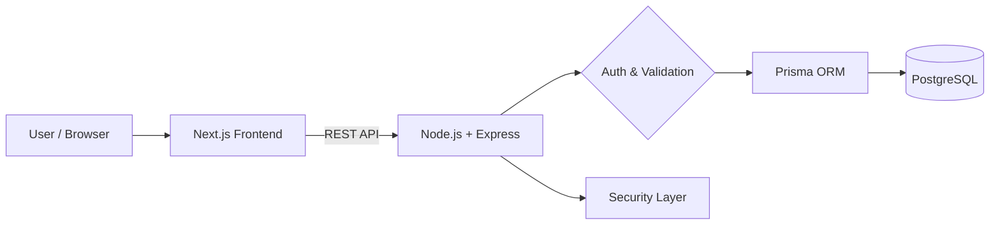

<h1 align="center">
  Hi 👋, I'm Mohamed Elshinawy
</h1>

  

  

  
  
  
  

## About me

I'm a Systems & Computers Engineering graduate (Al-Azhar University, Very Good) who builds production web applications end to end: designing data models, writing APIs, and shipping user-facing features.

- Two live products in production: a wholesale marketplace and a Quran learning platform
- Experienced with REST APIs, relational data modeling, authentication, and security hardening
- Security-minded: web application security fundamentals, TryHackMe labs, and the eWPT learning path
- IBM Certified: Developing Front-End Apps with React
- Open to software engineering roles and interesting projects

## Featured Projects

### 🛒 [Tojar Gomla](https://tojargomla.com): Wholesale Marketplace
A platform connecting wholesale traders with shop owners, built and run end to end.

**Stack:** Next.js · Node.js · Express · Prisma · PostgreSQL  
*Source is private (commercial product).*

### 📖 [Kouttab](https://kouttab.org): Quran Memorization & Tajweed Platform
Connects students who want to memorize the Quran and learn Tajweed with qualified Sheikhs, handling discovery, booking, and learning in one place.

**Stack:** Next.js · Node.js · Prisma · PostgreSQL  
*Source is private.*

### 🪴 [Paradise Nursery](https://github.com/eng-Sinawy/e-plantShopping): React Shopping App
Cart add/remove/update with dynamic totals, state managed with Redux, and reusable components.

**Stack:** React · Redux

## How I Build Production Apps

**Engineering principles I work by**
- 🧱 **Data model first:** a clean relational schema (Prisma + PostgreSQL) before any UI
- 🔐 **Security by default:** input validation, authentication, and authorization checks on every route
- 🧩 **Reusable components:** small, consistent UI pieces instead of copy-pasted pages
- 🚢 **Ship, then iterate:** both platforms are live and used by real people

## Currently

- 🔭 Improving and scaling my live platforms
- 🌱 Going deeper into web application security (eWPT path)
- 💬 Open to opportunities: [reach out](mailto:elshinawy83824964mo@gmail.com)

## Tech Stack

| Area | Tools |
|---|---|
| **Front-End** |       |
| **Back-End** |     |
| **Databases** |    |
| **Tools** |      |
| **Security** | CCNA networking fundamentals · Web pentesting basics · TryHackMe · eWPT path |

## Certification

🏆 **IBM: Developing Front-End Apps with React** (Coursera / Credly)

## GitHub Stats

  

  

<i>Build things that work. Make them better. Repeat.</i>

## Connect With Me

  
  
  

  

<h3 align="center">🚀 Code. Learn. Build. Repeat.</h3>
